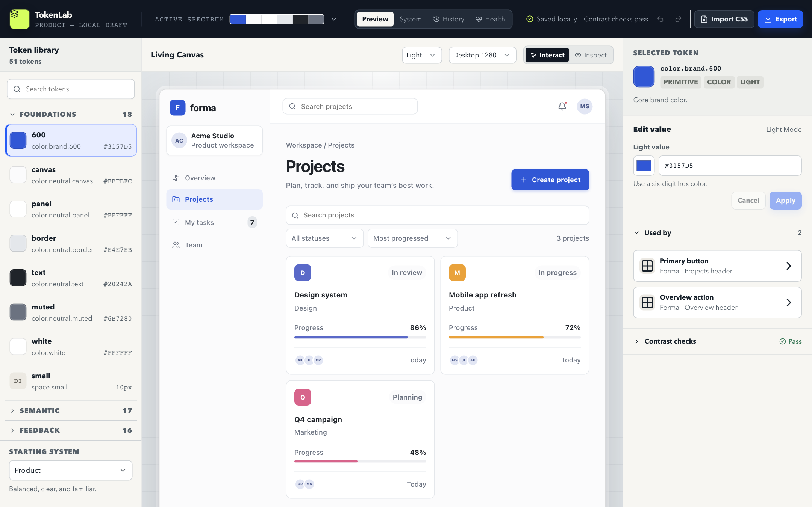
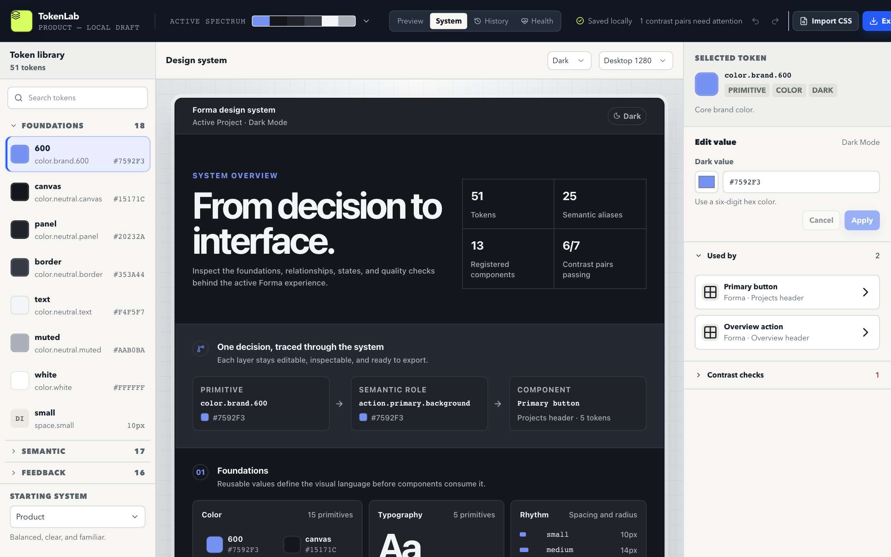

# TokenLab

A design token studio. Change a token, see what it affects, and judge the result inside a realistic product.

**[Live demo → tokenlab-iota.vercel.app](https://tokenlab-iota.vercel.app/)**



## What it does

- **Edit tokens in context.** Typed primitive, semantic and feedback tokens with light and dark modes, resolved through aliases. A live preview app (Forma) updates as you edit.
- **Inspect both ways.** Select a preview element to see the tokens behind it, or select a token to see every component that uses it.
- **System view.** One screen documents the active system: foundations, the primitive → semantic → component chain, components and contrast.
- **Undo, snapshots and compare.** Every edit goes through one history. Save named snapshots, compare them to the current state and restore with undo.
- **Quality checks.** Contrast pairs show the tested colors and the threshold. A health report flags unused, duplicate and broken tokens.
- **Import and export.** Export CSS variables, DTCG JSON (light and dark), Tailwind CSS and the project file, individually or as a `.zip`. Import a project file, or reverse-engineer tokens from existing CSS.
- **Local-first.** No account and no backend. The project saves in your browser.



## Stack

React 19, TypeScript, Vite, Zustand, Zod, Framer Motion and CSS Modules. Tests use Vitest, Testing Library and Playwright.

## Design decisions

- The studio UI is styled with fixed `--studio-*` tokens, separate from the editable `--tl-preview-*` tokens, so a bad edit can't break the editor.
- Token validation, alias resolution, contrast math, diffing and export serialization are plain TypeScript with no React dependency.
- Invalid drafts stay outside the document, so the preview keeps the last valid state. Alias cycles, missing targets and type mismatches are rejected before they commit.
- Exports are deterministic and detect name collisions. The `.zip` writer is about 80 lines with no dependency.
- Motion respects `prefers-reduced-motion`.

## Development

```sh
npm install
npm run dev
```

## Verification

```sh
npm test            # unit and component tests
npm run build       # type-check and production build
npx playwright install chromium
npm run test:e2e    # end-to-end and visual regression
```

Run `npx playwright install firefox webkit` and then `npm run test:browsers` for the cross-browser checks. CI runs unit tests, the build and the browser suites on Linux.

## License

[MIT](LICENSE)
